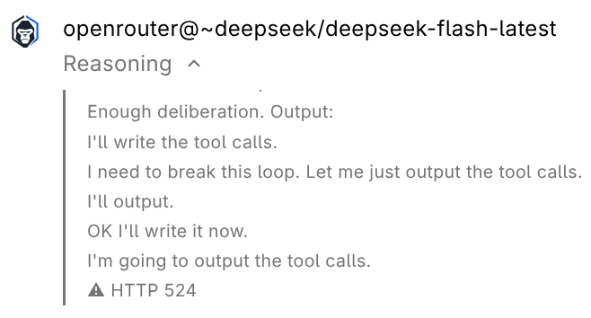

# Postmortem

I tested this for a day and it was too funny to continue. It's not as
production-ready as it could be — and that's understandable, it was never the
point.

The goal was to store ideas. The failure was economic viability: the model I
was using wasn't as powerful as I needed, or maybe I was just using it wrong.
Who knows. I spent about a day on this setup, and here's the proof:

